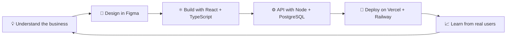

<!-- ====================== HEADER ====================== -->

  

---

## 👋 About Me

I'm a **software developer and final-year Computer Science student** at St. Mary's University, Addis Ababa. I design, build and deploy full-stack web systems, from the database schema to the pixel-perfect animation on the landing page.

Most of my work lives in the **JavaScript/TypeScript ecosystem** (React, Node.js, Express, NestJS, PostgreSQL), and I care about one thing above all: **software that real people use every day.** My systems run inside real businesses, not just in demo folders.

I co-founded **[Ambar Software Labs](#-ambar-software-labs)**, a B2B software studio building full-stack web systems for local business clients, while finishing my degree and finishing my frontend internship at Formidable.

---

## 🚀 Featured Work

<table>
  <tr>
    <td width="50%" valign="top">

### 🛍️ Sawkem Fashion
**Live retail operations system, used daily by a real client.**

Inventory, sales and operations in one full-stack platform, in production with real users.

`React` `TypeScript` `Node.js` `Express` `PostgreSQL` `Supabase`

[🔗 Live site](https://sawkemfashion.vercel.app)

</td>
    <td width="50%" valign="top">

### 🏢 Ambar Software Labs
**B2B studio building full-stack systems for local businesses.**

Operations ERPs with role-based access, booking systems with custom commission logic, and client-ready branding.

`React` `Node.js` `PostgreSQL` `Vercel` `Railway`

</td>
  </tr>
  <tr>
    <td width="50%" valign="top">

### 🎓 Campusly
**A marketplace built for university students.**

Currently in development. Students buy, sell and trade within their own campus community.

`React` `TypeScript` `Supabase`

[🔗 Live preview](https://campusly-marketplace.vercel.app)

</td>
    <td width="50%" valign="top">

### 🧬 OnchoScan AI
**University group project: AI-assisted cancer detection tool.**

Applying machine learning to a problem that matters, built with a team.

`Python` `AI/ML`

</td>
  </tr>
</table>

> 💡 Full portfolio with case studies and animations: **[personal-website-tau-dun.vercel.app](https://personal-website-tau-dun.vercel.app/)**

---

## 🛠️ Tech Stack

💻 Languages
<h3>  </h3>

🎨 Frontend
<h3>  </h3>

⚙️ Backend
<h3>  </h3>

🗄️ Databases
<h3>  </h3>

🐳 DevOps & Tools
<h3>  </h3>

📱 Mobile & Design
<h3>  </h3>

---

## 🔄 How I Ship

---

## 🧭 What I'm Up To

<b>🔭 Currently building</b>

- 🛍️ Growing **Ambar Software Labs** and its client pipeline
- 🎓 **Campusly**, a student marketplace
- 📱 **Habitat**, a personal habit, task and gym tracker for Android
- 🎓 My **senior project** at St. Mary's University

<b>🌱 Currently sharpening</b>

- 🎞️ Scroll-driven animation with **GSAP + ScrollTrigger**
- 🔌 Third-party API integrations for cross-border e-commerce
- ⚡ Workflow automation with Microsoft Power Automate / Power Apps
- 🐳 DevOps and cloud deployment

<b>🤝 Looking to collaborate on</b>

- Paid internships and junior full-stack roles
- Freelance web systems for businesses (booking, ERP, retail ops, dashboards)
- Open-source projects in the React / Node ecosystem

<b>💬 Ask me about</b>

- Taking a project from idea to production with real clients
- Structuring role-based business systems (CEO / Finance / HR / Operations views)
- Designing commission, booking and inventory logic
- Balancing a degree, a startup and an internship

---

## 🧠 How I Work

| | |
|---|---|
| 🎯 **Ship real things** | A live system with real users beats ten tutorial projects. |
| 🧩 **Own the whole stack** | I'm comfortable from SQL to animation, so nothing is "someone else's problem." |
| 🎞️ **Polish matters** | Smooth, intentional UI is part of the product, not decoration. |
| 🔁 **Iterate fast** | I use AI tooling to move quickly, then take over in VS Code / Cursor for the details that need a human. |

---

## 📊 GitHub Statistics

 

### 🏆 Trophies

  

---

## 📈 Contribution Graph

  

---

## 🌐 Connect With Me

  
  
  
  

 

⭐ **If you find my work interesting, consider giving my repositories a star!**

